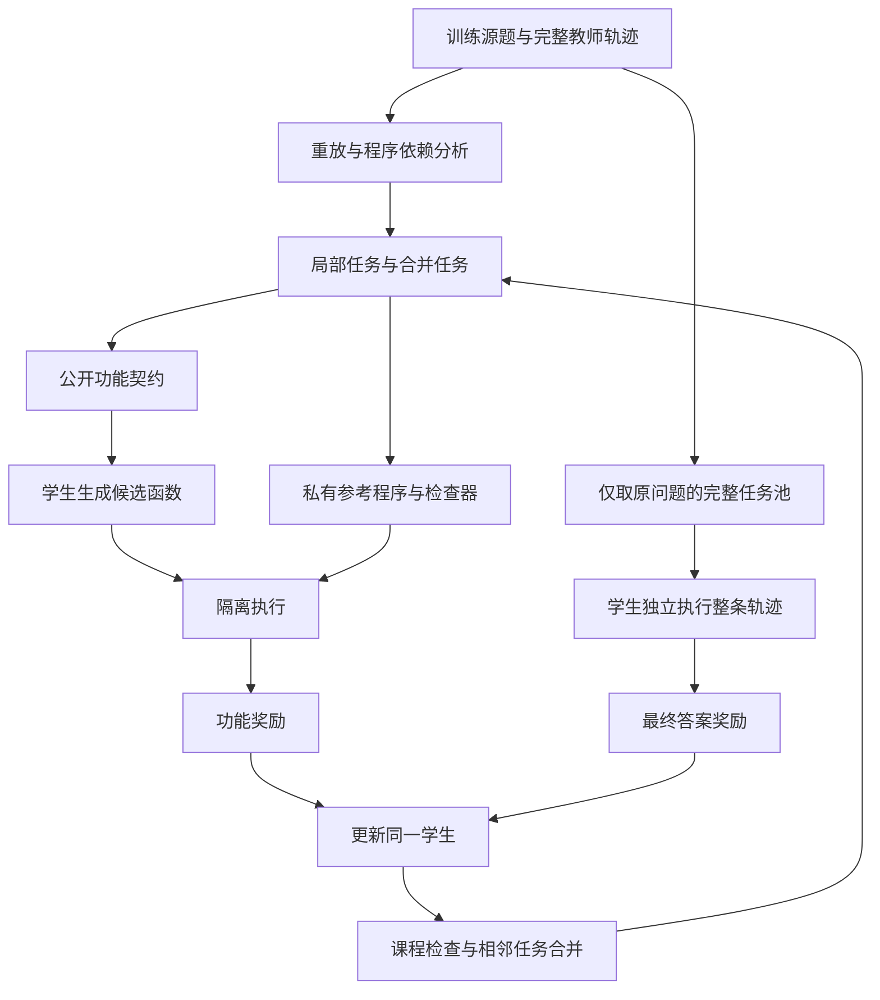

# 渐进式功能轨迹蒸馏：完整方法建模与实施方案

**暂定方法名：Progressive Functional Trajectory Distillation（PFTD，渐进式功能轨迹蒸馏）。** 名称用于当前讨论，尚未核对名称唯一性。

**文档性质：研究方法设计稿。** 本文把当前 idea 写成接近论文 Introduction、Problem Formulation、Method 和 Implementation 的完整技术方案，同时保留实施细节。PFTD 尚未训练或验证；所有训练规模、阈值和超参数均为拟定设置。文中的演示题用于解释算法，不能当作模型实验结果。此前 SCAD 的结果不属于 PFTD。

**版本：2026-10-10。** 本文细化同目录的 [初版协议](PROTOCOL_v1_2026-10-10.md)。遇到定义歧义，以本文为准。教师完整轨迹生成过程、原 agent 的工具接口和最终任务保持不变。

## 阅读导航

1. 研究动机与问题定位。
2. Agent 任务、轨迹及原始蒸馏目标。
3. PFTD 总体结构与继承关系。
4. 从教师轨迹编译功能任务。
5. 公开契约、私有检查器与上下文隔离。
6. 局部执行奖励与功能监督。
7. 学生的 GRPO 更新。
8. 逐级合并、辅助撤除与完整解题。
9. 端到端算法及一次更新的时间顺序。
10. 完整运行示例。
11. 数据结构、模块与运行配置。
12. 可行性验证、对照实验和停止条件。
13. 方法边界、可陈述主张与待确认问题。

## 1. 研究动机：把教师执行经验转成学生可以完成的练习

### 1.1 研究问题为什么重要

小语言模型可以通过检索和代码执行获得超出其参数记忆与心算能力的支持，但它仍然需要决定如何建模问题、何时使用工具、如何解释返回结果，以及怎样组织后续动作。工具替模型执行一个程序，并不能保证这个程序表达了正确的任务意图。

基线论文 *Distilling LLM Agent into Small Models with Retrieval and Code Tools* 使用教师生成的完整交互轨迹训练学生。学生学习教师的思考和动作，同时把工具观察作为上下文。这个范式已经提供了有效的工具使用初始化。我们的研究问题是：**在拥有同一批教师轨迹、同一学生和同一工具环境的条件下，能否让教师的执行过程提供比逐 token 模仿更直接的功能训练信号？**

这里的目标是提高学生无辅助完成新问题的能力。局部代码写得更像教师、局部检查通过率更高，都不能单独替代这个目标。

### 1.2 轨迹监督中的三个挑战

**示范写法与实际功能之间存在距离。** 对同一输入，多段不同代码可能实现同一个计算。单条轨迹 SFT 提高被记录代码的生成概率，却没有显式地把所有其他正确实现纳入监督。它也无法直接利用“学生写出了不同代码，但实现了相同功能”这一执行事实。这并不意味着 SFT 必然记忆模板，而是其优化目标没有单独表达功能等价性。

**完整任务的反馈难以定位局部缺口。** 学生从头探索整题时，错误可能发生在问题建模、约束筛选、数值计算、工具调用或结果解释等环节。若训练只使用最终对错，同一个失败奖励无法区分这些原因。对于当前成功率较低的小模型，若一组候选全部失败，基于组内相对奖励的更新还可能缺少方向。

**给出局部目标不等于学会自主规划。** 把复杂任务拆成小练习可以降低探索难度，但提供输入状态、任务分解和输出接口也替学生完成了一部分决策。若训练长期依赖这些辅助，学生可能学会完成指定函数，却仍然不能从原问题出发组织整条轨迹。因此，局部训练必须包含辅助撤除和无辅助完整任务训练。

### 1.3 核心 insight 与方法假设

一条代码工具轨迹同时包含文本示范和可执行计算。对于其中可重放、依赖明确的部分，我们可以把教师程序转换成有明确输入、输出与检查方式的局部任务。学生自行生成实现，通过真实执行获得奖励。随着学生掌握局部任务，训练系统合并相邻任务，减少提供的中间状态与分解信息，最后完全回到原始 agent 任务。

PFTD 的学习路线为：

> 完整教师示范 → 可验证的局部功能任务 → 学生自己的实现 → 更大范围的组合任务 → 原始问题上的独立交互。

本文待检验的假设有三个：

- H1：功能检查能为不同但正确的学生实现提供有效监督，减少对教师特定写法的依赖。
- H2：局部任务可以增加有限生成预算下有区分度的奖励组，缓解整题探索初期的反馈稀疏。
- H3：逐级扩大任务范围并持续混合整题训练，可以把局部功能提升迁移到无辅助完整解题。

这些是假设，不能在没有实验时写成已证实的结论。

## 2. 任务定义与原始 Agent Distillation

### 2.1 问题、环境与学生策略

令训练集为

$$
\mathcal D_{\mathrm{train}}=\{(q_i,y_i)\}_{i=1}^{n},
\tag{1}
$$

其中 $q_i$ 是问题，$y_i$ 是训练时可用的参考答案或判定依据。$y_i$ 只对训练侧判分器可见，不进入学生解题提示。

用 $s_t$ 表示工具环境在第 $t$ 次动作前的内部状态，包含执行所需的变量和工具状态。学生实际看到的是交互历史

$$
h_t=(q,r_1,a_1,o_1,\ldots,r_{t-1},a_{t-1},o_{t-1}),
\tag{2}
$$

其中 $r_t$ 为学生生成的思考，$a_t$ 为动作或代码，$o_t$ 为真实工具观察。学生不必能直接读取完整的内部状态 $s_t$。

交互过程写为

$$
(r_t,a_t)\sim\pi_\theta(\cdot\mid h_t),\qquad
(s_{t+1},o_t)=\mathcal E(s_t,a_t).
\tag{3}
$$

工具执行失败可以作为真实观察反馈给学生，让其在原 agent 允许的轮数内修正；基础设施故障则不属于有意义的学生行为反馈。

完整轨迹为

$$
\tau=(r_1,a_1,o_1,\ldots,r_T,a_T,o_T,\hat y),
\tag{4}
$$

其中 $\hat y$ 是最终答案。设 $V(q,\hat y,y)\in\{0,1\}$ 为固定的任务判分器。最终目标是提高未见问题上的独立成功率：

$$
J_{\mathrm{task}}(\theta)=
\mathbb E_{(q,y)\sim\mathcal D_{\mathrm{target}}}
\mathbb E_{\tau\sim\pi_\theta,\mathcal E}
[V(q,\hat y(\tau),y)].
\tag{5}
$$

式 (5) 定义研究目标，不表示训练时可以访问目标测试集。正式测试集只在冻结方法后用于评测。

### 2.2 教师完整轨迹保持不变

令 $\pi_T$ 为教师策略，生成

$$
\tau_i^T\sim(\pi_T,\mathcal E)\mid q_i.
\tag{6}
$$

沿用基线的教师轨迹生成方式，包括适用的 FTP 提示。保留通过任务判定的完整示范，形成 $\mathcal D_T$。已有轨迹可以复用，无需为了本方法重新生成全部数据。

“最终答对”是进入轨迹池的条件，不等于轨迹每个中间步骤都正确；编译局部任务还需要额外验证。

### 2.3 原论文的训练目标

把教师交互序列序列化成 token 序列 $z^T$。令 $m_j^T=1$ 表示位置 $j$ 属于教师生成的思考或动作，工具观察和输入提示对应 $m_j^T=0$。原始监督目标可写为

$$
\mathcal L_{\mathrm{SFT}}(\theta)=
-\mathbb E_{(q,\tau^T)\sim\mathcal D_T}
\left[
\frac{1}{\sum_jm_j^T}
\sum_jm_j^T\log\pi_\theta(z_j^T\mid q,z_{<j}^T)
\right].
\tag{7}
$$

观察 token 不计算生成损失，但仍然是后续动作的输入上下文。不能把 loss masking 解释成学生看不到工具返回。

本文用 $\theta_0$ 表示原论文 SFT 后的学生参数。PFTD 从这个初始化出发，改变新增训练阶段，而不是声称无需任何工具使用初始化。SAG 是基线推理时的候选动作选择机制，不是原学生的 GRPO 训练过程。

### 2.4 符号表

| 符号 | 含义 |
|---|---|
| $q,y,\hat y$ | 问题、参考答案、学生答案 |
| $s_t,h_t$ | 环境内部状态、学生可见交互历史 |
| $\pi_T,\pi_\theta,\pi_{\theta_0}$ | 大教师、当前学生、冻结的初始化学生 |
| $\tau^T$ | 教师完整轨迹 |
| $P_q$ | 从可支持轨迹提取的确定性参考程序 |
| $c=[l,r]$ | 参考程序中的一个连续完整语句区间 |
| $I_c,O_c$ | 区间入口依赖、出口接口 |
| $F_c^T,f_\omega$ | 教师局部函数、学生生成的候选函数 |
| $d_c$ | 局部功能要求与接口契约 |
| $\mathcal U_c$ | 私有检查上下文集合 |
| $R_c$ | 候选在局部任务上的执行奖励 |
| $G,K$ | 同一提示的候选数量、共享测试上下文数量 |
| $b$ | 已使用学生生成 token 占总预算的比例 |

## 3. 渐进式功能轨迹蒸馏（PFTD）

### 3.1 三个模块与两种学习情境

PFTD 包含轨迹编译器、功能执行检查器和渐进式任务调度器。三个模块共同服务于一个学生模型，不给不同局部任务建立不同模型。

训练有两种情境：

1. **局部或合并功能任务**：学生只看到独立的功能说明和接口，生成一个函数，通过隐藏执行检查获得奖励。
2. **完整 agent 任务**：学生从原始问题开始，与原工具环境交互，通过最终正确性获得奖励。

局部任务为学生提供了训练侧的任务分解信息。完整任务不提供这些信息。二者交替更新同一个学生，并逐渐提高完整任务的比例。



图中的私有检查器只向优化器提供奖励和有效性状态，不向学生的文本提示提供未来轨迹或参考值。

### 3.2 相对于基线的边界

| 内容 | 继承基线 | 本方法新增 |
|---|---|---|
| 教师完整轨迹及 FTP | 是 | 无需改变生成范式 |
| 学生骨干、LoRA 初始化、代码工具 | 是 | 继续训练同一模型 |
| 轨迹的作用 | 提供思考和动作示范 | 额外编译成功能任务和执行反馈 |
| 新增阶段的优化目标 | 基线为监督模仿 | 局部执行奖励与整题奖励下的策略优化 |
| 从局部到完整 | 不属于原 SFT 目标的显式结构 | 重新编译合并任务、撤除中间输入和分解辅助 |
| 测试输入 | 原始问题与工具 | 保持一致，无教师分解或检查器 |

新增训练不要求再次逐 token 模仿教师片段。用于稳定更新的冻结参考策略是 $\pi_{\theta_0}$，不是在线大教师。

## 4. 从教师轨迹编译可验证的功能任务

### 4.1 支持范围与程序提取

v1 聚焦确定性的数学 Python 计算。优先支持数字、布尔值、简单容器、纯函数和明确的数学库调用。网络检索、文件系统修改、随机状态、复杂对象别名及不可重放的外部副作用不进入局部编译池。

对一条教师轨迹，提取其中的代码动作并保留来源位置、导入依赖和必要的执行顺序。在原环境中重放，得到参考执行状态序列。用新进程重复重放并核对输出，验证它可复现。最终答案仍使用固定的任务判分器核验。

仅当记录的代码可以表达为受支持的确定性计算时，记其为

$$
P_q=B_1;B_2;\cdots;B_M,
\tag{8}
$$

其中每个 $B_j$ 是完整语法节点。多轮教师动作可能依赖先前观察后的自然语言判断，不能无条件把所有代码拼接成一个对任意输入都正确的通用程序。若新输入会要求教师重新决定下一步动作，而固定代码无法覆盖该变化，则不为该轨迹生成这类输入变体。

### 4.2 语法边界与依赖边界

候选区间 $c=[l,r]$ 由连续、完整的语句组成。完整循环、分支、异常结构或函数定义保持原子性；不按 token 数截断。优先考察工具回合边界，其次考察单个工具代码块内部的完整语句边界。

对区间进行保守的 read-before-write、定义使用及副作用分析：

$$
I_c=\operatorname{ReadBeforeLocalDef}(B_l;\ldots;B_r),
\tag{9}
$$

$$
O_c=\operatorname{Def}(c)\cap
\operatorname{LiveAfter}(r).
\tag{10}
$$

$\operatorname{LiveAfter}(r)$ 指区间之后、被重新定义之前仍会读取的变量或任务可观察输出。式 (9) 不能简单实现成“所有读取变量减去所有写入变量”，因为一个变量可能先读取、后赋值。

对于多个分支，保守合并所有可达路径的依赖。不确定时扩大区间或拒绝候选，不以一次运行观察到的依赖替代所有必要的静态检查。动态记录用于验证静态结果和采集样本，并不单独证明一般程序依赖。

### 4.3 包装为局部函数

设 $s_l$ 是教师执行到区间入口时的状态，$\operatorname{Proj}_{I_c}$ 提取所需输入。参考函数为

$$
u=\operatorname{Proj}_{I_c}(s_l),\qquad
F_c^T(u)=\operatorname{Proj}_{O_c}
\bigl(\operatorname{Exec}(B_l;\ldots;B_r,s_l)\bigr).
\tag{11}
$$

式 (11) 成立的前提是 $I_c$ 加上声明的固定运行依赖足以决定出口结果；存在未声明依赖的候选不合格。

编译器生成固定名称的函数接口，例如 `solve_unit(candidates)`。多个出口可以使用固定顺序的 tuple 或声明字段的结构化返回值。边界适配器负责把返回结果映射回参考程序的变量名，学生不能任意修改教师的全局状态。

内部变量、循环结构与具体算法允许变化，但接口的语义约束保留。这样提供的是一组兼容实现的空间，不是所有可能整题解法的空间。后续任务合并会扩大可自由选择算法的范围。

### 4.4 哪些区间值得保留

候选需满足：依赖闭合、可重放、接口可描述、输出可验证，并且对应实际任务中的非平凡计算。初始每题最多保留三个去重后的局部候选。

排除以下情况：

- 只打印、格式化或提交已经算出的答案。
- 无需读取输入即可返回本题固定结果。
- 后续代码在读取局部输出前总会重算或覆盖它。
- 正确性依赖无法清楚描述的隐藏状态。
- 局部说明必须暴露参考答案才能成立。
- 当前只有一个固定输入，且无法构造足够的合法检查上下文。

进行有针对性的错误注入：改比较符号、删除约束、返回常量、遗漏元素或改变必要输出。局部检查应识别确实错误的变体；后续使用关系也应有可观察证据。不是所有程序变异都错误，不能将等价变异强行标负。

### 4.5 公开契约的生成

为候选生成契约

$$
d_c=(g_c,\mathcal X_c,\mathcal Y_c,\mathcal A_c),
\tag{12}
$$

其中 $g_c$ 是功能说明，$\mathcal X_c$ 是合法输入范围，$\mathcal Y_c$ 是输出语义与类型，$\mathcal A_c$ 是允许的运行依赖。

任务说明生成器可以读取原题、当前区间代码及输入输出接口，但不能读取未来轨迹、具体参考输出、标准答案字段或判分结果。它只描述需要完成的功能，避免把实现步骤改写成提示。

接口抽取可以由程序分析直接完成，自然语言功能说明的准确性则需要验证。v1 使用受限说明模板、结构化字段校验、参考执行检查和首批人工抽查。无法可靠说明的区间直接退出局部训练池，不能声称对任意代码全自动提取语义能力。

数学条件中的常数可以出现在契约中，例如“能被 3 整除”；从当前题目计算出的目标数值不能伪装成题目条件。变量名也需要去除 `answer_120` 一类携带结果的编码。

## 5. 检查上下文与信息隔离

### 5.1 合法检查上下文从哪里来

对区间 $c$ 构造私有上下文

$$
\xi_{c,k}=(s^{\mathrm{pre}}_{c,k},u_{c,k},v^T_{c,k},
q_{c,k},y_{c,k},P^{\mathrm{post}}_{c,k}),
\tag{13}
$$

其中 $s^{\mathrm{pre}}$ 是只执行参考前缀获得的入口状态，$u$ 是输入投影，$v^T$ 是参考输出，$P^{\mathrm{post}}$ 是与该上下文匹配的冻结后续程序。$q_{c,k},y_{c,k}$ 仅在可以验证对应完整任务时使用。

主要路径是对原问题中明确可参数化的量作合法修改，保持问题语义一致，然后重新执行完整的参考前缀获得入口状态。例如把泛化任务中的 $N$ 从 10 改为 30，必须同步更新问题实例和前缀，不能仅改中间列表中的一个元素。

允许对具有明确独立定义域的纯函数生成额外局部输入，但若它不能对应合法的整题执行上下文，就不能伪造后续集成检查。v1 主奖励池只接纳同时具有合法局部检查和后续检查的上下文；其他纯函数测试可用于诊断，不能混入同一指标。

更换输入后，固定的教师后续代码可能包含过时的数值或决策。对此需要在完整参考程序层面重新核验；无法处理就拒绝该变体。不能以“代码仍能运行”代替语义一致性。

### 5.2 参考一致性与数学正确性分开

参考程序可以生成 $v^T=F_c^T(u)$，但这只给出行为参照。数学功能正确性还需要独立的枚举、符号核验或明确的任务约束支持。编译记录保留 `verification_level`：

- `semantic_checked`：契约和测试依据清楚，并有独立验证支持。
- `reference_only`：只确认与教师输出一致，不宣称语义正确。
- `invalid`：说明、状态或结果存在冲突。

v1 主局部训练池使用第一类。第二类用于统计覆盖率和后续研究，不能通过改名混入“可靠功能监督”。这会限制覆盖率，必须如实报告。

初始每个单元至少六个合法训练检查上下文。另外保留只用于课程判断的输入池；独立开发集则来自不同源题，三者用途不能混淆。

六个上下文不能只是任意抽六个数。优先覆盖原始实例、合法边界、一般输入以及针对常见错误构造的反例，并逐个确认参考程序自身通过独立检查。若某类错误在这六个输入上仍无法区分，需要增加有依据的反例或拒绝该单元，不能把“数量达到六个”当作充分验证。训练检查输入、课程检查输入和独立开发输入分别记录用途和首次使用时间。

### 5.3 公开视图和私有视图

每个单元保存两份物理分离的记录：

| 学生公开视图 $p_c$ | 检查器私有视图 $w_c$ |
|---|---|
| 功能说明、函数签名 | 教师代码及来源区间 |
| 输入类型与允许范围 | 具体检查输入与入口状态 |
| 返回类型和语义约束 | 参考输出与独立核验依据 |
| 允许的库和响应格式 | 冻结后续程序、最终参考答案 |
| 必要的题目条件 | 教师完整轨迹、错误诊断和覆盖记录 |

学生提示由白名单构建：

$$
p_c=\operatorname{Render}(d_c,\text{interface}_c,
\text{response format}).
\tag{14}
$$

不从完整对话中“删几段”来生成提示，也不把私有结构传入聊天模板后再做正则清洗。v1 局部提示不提供教师示范、输入输出样例或实际测试数据。

在固定学生参数和公开视图时，应满足检查器信息不影响生成上下文：

$$
\pi_\theta(\omega\mid p_c,w_c)
\equiv\pi_\theta(\omega\mid p_c),
\tag{15}
$$

这里的左侧是隔离要求：实现中根本不把 $w_c$ 输入模型。替换私有答案或参考程序时，生成请求的 token 和注意力上下文必须不变。训练之后奖励改变参数是预期学习过程，不与式 (15) 冲突。

### 5.4 三类状态必须分离

**生成状态**只包含公开提示与学生自己生成的 token。局部任务是一轮代码生成，检查器不给模型追加私有测试错误或参考值。

**候选执行状态**是一个新建的隔离执行器，只含当前函数、声明的实参和允许依赖。函数在运行时读取实参属于正常程序行为；它不能读取答案文件、参考函数、其他候选或检查器内存。

**后续检查状态**由检查器另开环境，重新执行该测试上下文的参考前缀，再将学生声明的输出注入出口接口并运行后续程序。禁止从教师执行完成后的环境中复制 globals，因为那里可能已经有正确的出口和答案。

候选运行使用受限解释器或适当隔离机制。仅限制 Python 的 globals 字典并不构成充分隔离。参考代码和答案不放入候选执行器的可读资源。

### 5.5 其他污染路径

- 先按源题及可识别的近重复/模板家族划分，再生成全部切片和变体；所有派生任务继承同一 split。
- 不同候选和输入分别初始化运行环境，防止一个候选写入状态影响另一个。
- 默认不拼接不同训练样本；若启用 packing，必须隔离注意力。loss mask 为零不代表上下文不可见。
- 重用 KV cache 仅限完全一致的合法前缀，不跨不匹配任务共享状态。
- 完整 agent 轨迹中的观察始终来自该学生自己的真实执行；绝不在学生偏离教师后附加教师旧观察。
- 候选采样与策略更新使用相同提示。不能先带答案生成，再删除答案重算概率并称为 on-policy 更新。

## 6. 功能监督：对学生实现进行两层执行检查

### 6.1 接受不同的正确实现

学生根据 $p_c$ 生成响应 $\omega$，解析其中的代码得到函数 $f_\omega$。对输入 $u_{c,k}$，得到

$$
v_{\omega,k}=\operatorname{ExecIsolated}(f_\omega,u_{c,k}).
\tag{16}
$$

执行失败或违反接口时返回失败标记 $\bot$。成功并不要求 $f_\omega$ 与 $F_c^T$ 的源码一致。

定义局部功能判定

$$
L_{c,k}(\omega)=
\mathbf 1[v_{\omega,k}\neq\bot]
\cdot V_c^{\mathrm{func}}(u_{c,k},v_{\omega,k};d_c,v^T_{c,k}).
\tag{17}
$$

$V_c^{\mathrm{func}}$ 检查类型、契约和结果。对于精确数值可直接比较；对于集合语义检查成员和必要的重复约束；对于浮点结果使用预先固定的绝对/相对容差。不能为了让某个候选通过而临时改变比较规则。

如果契约允许多种结果表示，应在检查器中定义规范化或独立后置条件。例如“无重复、顺序不限”的整数列表需要同时检查元素正确和无重复，不能直接转成 set 后忽略重复错误。

在有限检查上下文下，定义经验接受集合

$$
\mathcal F_c^{\mathrm{pass}}
=\{f_\omega:\ \forall k,\ L_{c,k}(\omega)=1\}.
\tag{18}
$$

训练希望增加生成这个集合中函数的概率，而非仅增加教师源码的概率。式 (18) 是有限测试下的接受集合，不是对所有合法输入的程序等价证明。近似浮点比较也不必具有数学等价关系的全部性质，因此本文不将它直接称为严格等价类。

### 6.2 后续执行兼容性

局部检查后，在新的检查环境中重放教师前缀。用边界适配器 $\operatorname{Inject}_c$ 写入学生输出：

$$
s'_{c,k}=\operatorname{Inject}_c(s^{\mathrm{pre}}_{c,k},v_{\omega,k}).
\tag{19}
$$

然后执行该上下文匹配的参考后续程序，得到 $\hat y^{\mathrm{post}}_{\omega,k}$，定义

$$
I_{c,k}(\omega)=
\mathbf 1[\text{后续执行有效}]
\cdot V(q_{c,k},\hat y^{\mathrm{post}}_{\omega,k},y_{c,k}).
\tag{20}
$$

若学生局部输出已经无效，则无需运行后续，直接令 $I=0$。后续执行器不调用语言模型，也不把教师未来观察交给学生；它只检查可支持的冻结代码计算。

两层检查针对不同风险：局部判定防止错误结果被后续聚合掩盖；后续判定检查接口、状态与后续计算的真实兼容性。某些单元中二者信息可能重复，不能假设集成检查一定额外提升效果，需要消融验证。

### 6.3 奖励定义

对同一组候选共享的 $K$ 个有效上下文，采用

$$
R_c(\omega)=\frac{1}{K}\sum_{k=1}^{K}
L_{c,k}(\omega)I_{c,k}(\omega).
\tag{21}
$$

这是测试通过比例。学生不能通过只满足局部格式或只让后续程序凑巧答对获得满分。v1 不额外奖励短输出或少工具调用，避免用效率偏好干扰正确性学习。

完整任务使用

$$
R_{\mathrm{full}}(\tau)=V(q,\hat y(\tau),y),
\tag{22}
$$

并沿用原任务的执行预算与有效终止要求。基础设施错误与模型行为错误分别记录：学生语法错误、非法返回或可归因于学生程序的资源超限可判失败；检查器宕机、参考程序本身失败或环境配置错误不能给学生负标签，应将对应组作废并修复。

### 6.4 理想条件下的组合解释

考虑一个确定性参考程序，若某区间的全部外部依赖都在 $I_c$ 中，所有对后续可观察的修改都在 $O_c$ 中，而且替代实现对所有可达入口给出相同的必要出口，则替换该区间不会改变后续程序可观察的最终结果。

证明思路是直接代入：替换前后的前缀状态相同；区间向后续暴露的接口结果相同；冻结的确定性后续因此得到相同输入并产生相同结果。对多个依次满足这些条件的区间，可以逐个替换。

这个结论解释接口检查的作用，但其强假设不能由六个测试样本自动满足。它也不保证学生会从新问题中自行选择正确的子任务顺序。PFTD 的有限测试监督和整题迁移仍是经验问题，不以这段解释代替实验或形式化验证。

## 7. 学生学习：共享模型上的局部与整题 GRPO

### 7.1 策略、候选与真实采样上下文

从 $\theta_0$ 初始化学生，骨干和原 agent 接口保持不变，训练其 LoRA 参数。每一轮收集 rollout 前冻结当前采样策略 $\pi_{\mathrm{old}}$。

对于同一个局部提示 $p_c$，采样

$$
\omega_1,\ldots,\omega_G\sim\pi_{\mathrm{old}}(\cdot\mid p_c),
\qquad R_i=R_c(\omega_i).
\tag{23}
$$

所有候选使用同一组 $K$ 个检查上下文，避免不同测试难度导致伪偏好。不同更新组可以按预先声明的规则刷新检查上下文。

对于完整题，候选是同一问题上独立执行的学生 agent 轨迹。每个候选使用新的工具环境；后续观察取自该候选的执行，不复用其他候选结果。

v1 为避免行为分布与概率比不一致，rollout 使用温度 1、无 top-k/top-p 截断，并保存真实上下文中的 old log-prob。若后续改用温度或截断采样，需重新明确实际行为分布与概率比定义，不能直接沿用未变换的原始概率。

### 7.2 组内相对优势

计算

$$
\bar R=\frac1G\sum_{i=1}^{G}R_i,
\qquad
\sigma_R=\sqrt{\frac1G\sum_{i=1}^{G}(R_i-\bar R)^2},
\tag{24}
$$

$$
\hat A_i=\frac{R_i-\bar R}{\sigma_R+\varepsilon_A}.
\tag{25}
$$

奖励和优势都作为停止梯度的外部信号。局部任务与整题任务分别在各自的同提示组内计算优势，不把不同问题的绝对奖励直接混成一个组。

$\varepsilon_A$ 是数值稳定常数，初始取 $10^{-8}$，与后面的策略截断宽度 $\epsilon$ 不同。

若同组奖励完全相同，v1 跳过该组的优化，包括该组的 KL 项，并记录 `zero_variance_group`。全对组可以减少抽样或触发更大任务；全错组可以退回有效的较小任务，或在预算允许时另收集一组更多候选。所有新增生成都计费，不能反复免费采样直到出现成功。

教师实现不能被加入组内并标成学生采样结果；也不能把“与教师更相似”临时当作伪奖励来制造方差。全零组比例本身是可行性诊断指标。

### 7.3 更新哪些 token

令 $z_{i,j}$ 为候选 $i$ 的第 $j$ 个序列化 token，$c_{i,j}$ 为它生成时的真实上下文。定义

$$
m_{i,j}=\begin{cases}
1,&\text{该 token 由当前学生生成，属于 Thought/Code/有效终止序列；}\\
0,&\text{输入提示、工具观察、教师材料或检查器内容。}
\end{cases}
\tag{26}
$$

局部情境下，学生生成函数实现；完整情境下，学生生成多个工具动作。完整轨迹中工具观察虽然影响后续上下文，但不作为策略动作更新。

位置概率比为

$$
\rho_{i,j}(\theta)=
\exp\bigl[\log\pi_\theta(z_{i,j}\mid c_{i,j})
-\log\pi_{\mathrm{old}}(z_{i,j}\mid c_{i,j})\bigr].
\tag{27}
$$

这要求采样和更新使用同一上下文、同一 tokenizer 与序列化规则。不能把 teacher-forced 前缀的概率当作学生实际采样概率。

### 7.4 优化目标

用固定的初始化学生 $\pi_{\theta_0}$ 作为参考策略。设

$$
D_{i,j}(\theta)=D_{\mathrm{KL}}
\bigl(\pi_\theta(\cdot\mid c_{i,j})\,\|\,
\pi_{\theta_0}(\cdot\mid c_{i,j})\bigr),
\tag{28}
$$

并令 $n_i=\sum_jm_{i,j}$。最大化每个有效组的目标

$$
\mathcal J_G(\theta)=
\frac1G\sum_{i=1}^{G}\frac1{n_i}
\sum_jm_{i,j}
\left[
\min\left(
\rho_{i,j}\hat A_i,
\operatorname{clip}(\rho_{i,j},1-\epsilon,1+\epsilon)\hat A_i
\right)-\beta D_{i,j}(\theta)
\right].
\tag{29}
$$

式 (29) 沿用 GRPO 类的策略更新，创新候选是训练任务和奖励的构造，不是该优化器。实现时最小化 $-\mathcal J_G$，避免奖励方向写反。

公式采用明确的逐上下文 KL；实现可按 token 分块计算，避免同时保留巨大词表张量。若改用 sampled KL 估计，应记录估计方式及近似性质，不能把不同实现默认为相同目标。响应长度归一化属于优化器设计，仍需在对照中固定；不加长度奖励不代表所有长度效应都自动消失。

v1 每个优化批先采用一组四个候选。四个候选采样期间参数保持不变；训练 microbatch 为 1 时，分别反向传播并按组目标累积梯度，四个候选处理完毕后才执行一次优化步骤。不能每生成或处理一个候选就更新模型，再把不同采样策略的候选当成同一组。随后刷新 $\pi_{\mathrm{old}}$。扩大批内组数、重复更新次数或候选数属于后续超参数变化，必须单独记录。

### 7.5 为什么这不同于“筛出成功代码再做 SFT”

SFT 使用固定的目标程序作为标签。这里的动作由当前学生生成，优劣由执行后的功能表现决定，奖励高于组平均的实现被增强，低于组平均的实现被压低。不同正确实现可以共同获得奖励。

需要承认：如果把成功候选保存下来再监督微调，那是另一种合理的训练方法，但不等同于上述 on-policy 更新。实验中可以把它作为对照，不能在实现中悄悄替换后仍沿用 GRPO 的文字描述。

## 8. 逐级接管：任务合并与教师辅助撤除

### 8.1 为什么局部训练需要显式组合阶段

局部任务提供了功能目标、输入类型和边界。即使学生每个局部函数都写对，也不意味着它会自行选择这些函数、按正确顺序组合或识别新问题所需的结构。因此，PFTD 不把局部通过率视为完整能力，而是把它用于调度更大任务。

### 8.2 任务图和区间合并

对每条支持的参考程序建立顺序与数据依赖图 $\mathcal G_q$。图节点对应基础程序块，边记录定义使用关系，另保留源程序的合法语句顺序。一个可训练单元对应依赖闭合的连续区间。

若两个相邻区间 $c_1=[l,m]$ 和 $c_2=[m+1,r]$ 均合法，可以提出父任务

$$
c_{12}=c_1\oplus c_2=[l,r].
\tag{30}
$$

父任务重新计算 $I_{c_{12}},O_{c_{12}}$、任务说明、参考函数、测试上下文和奖励。不能把两个旧提示拼接起来，也不能把两个子任务的中间参考结果一起给学生。

在依赖兼容的情况下，参考功能可理解为

$$
F_{c_{12}}^T(u)=F_{c_2}^T(F_{c_1}^T(u)),
\tag{31}
$$

实际存在旁路输入或多个输出时，用重新编译的程序状态传递实现，不能机械套用单输入函数复合。

父任务只规定入口和最终出口，因此学生可以选择不同中间表示。例如子任务要求生成候选列表并筛选，合并后的任务只要求给出满足条件的和，学生可以直接使用等差数列公式，不再被强制要求构造列表。

### 8.3 一个具体的合并链

```text
局部任务：输入 candidates，输出满足条件的 valid
    ↓ 合并上游范围构造
较大任务：输入 N，输出 1..N 中满足条件的 valid
    ↓ 合并下游聚合
完整计算任务：输入 N，输出满足条件的整数之和
    ↓ 撤除函数接口与分解目标
原始 agent 任务：读自然语言问题，自行建模并使用工具提交答案
```

前三层仍然是训练辅助任务。最后一层使用原任务格式，不能因父任务已经覆盖全部代码就宣称自动完成了格式迁移和自主规划学习。

### 8.4 合并准备度

使用训练源题派生的“课程检查池”估计单元掌握度。这些输入不用于该次策略梯度奖励，但因为它们影响调度，仍属于训练资源，不能冒充独立开发或测试数据。

在一次课程检查中，生成 $G_s$ 个新候选，要求候选通过全部 $K_s$ 个课程检查输入。定义

$$
\hat p_c=\frac1{G_s}\sum_{g=1}^{G_s}
\mathbf 1\left[\forall k\le K_s,
L_{c,k}(\omega_g)I_{c,k}(\omega_g)=1\right].
\tag{32}
$$

初始采用 $G_s=4,K_s=4$，最近两次检查均达到 $\hat p_c\ge0.75$ 时标记为可合并。阈值只是调度启发式，不是统计显著性或泛化保证；课程检查生成同样计入预算。

相邻子任务达到门槛、父任务编译和验证成功后，局部任务池增加父任务并降低子任务抽样权重。父任务持续全零时可暂时回退，不能无限停留在某个难度。最终阶段仍按预算进入完整任务训练。

为节省生成，课程检查仅对近期训练中已有成功信号的活跃单元进行；累计每用掉总预算的约 10% 时刷新一次，实际开销独立记录。无资格父任务时，局部预算使用仍有学习信号的基础任务；局部池为空则将剩余额度转给整题训练。

### 8.5 固定预算下的训练日程

令 $B$ 为学生总生成 token 预算，包含失败候选、重采样、完整轨迹和课程检查。令 $b=N_{\mathrm{generated}}/B$。初始设置：

| 阶段 | 预算进度 | 局部/合并任务生成额度 | 无辅助完整任务生成额度 |
|---|---|---:|---:|
| 局部能力形成 | $0\le b<0.3$ | 60% | 40% |
| 合并与接管 | $0.3\le b<0.7$ | 30% | 70% |
| 独立解题 | $0.7\le b\le1$ | 0% | 100% |

比例针对策略训练 rollout 的 token 额度；课程检查作为单列开销纳入总 $B$。调度器按两类已用 token 的额度差选择下一组，不能直接按“60% 样本”替代“60% token”。单组跨过阶段边界时记实际超出量，不丢弃已经生成的数据或隐瞒成本。

设该调度器在进度 $b$ 诱导的提示分布为 $\mathcal Q_b$，总体训练目标表达为

$$
\max_\theta\ 
\mathbb E_{\substack{p\sim\mathcal Q_b\\
\boldsymbol\omega\sim\operatorname{Rollout}(\pi_{\mathrm{old}},\mathcal E\mid p)}}
\left[\mathcal J_G(\theta;p)\right].
\tag{33}
$$

$\mathcal Q_b$ 是随课程变化的辅助训练分布，并不等于原始问题分布。不能声称式 (33) 在所有阶段都是式 (5) 的无偏优化；后期回到整题任务是为了减小这种差异，效果需要验证。

式 (33) 的 $\boldsymbol\omega$ 表示同提示的一组学生候选：局部任务是生成的函数响应，完整任务是带真实工具执行的交互轨迹。局部候选生成完成后才由私有环境打分，生成过程本身不访问检查器。

### 8.6 所有源题都保留完整训练机会

先按源题均匀选择，再在其可用局部任务中抽样；对没有局部任务的源题，完整任务池仍然保留。报告可编译与不可编译子集上的结果，检查方法是否只对容易编译的题型有效。

最终推理只保留学生、原始问题提示和原工具。没有教师轨迹、子任务契约、课程检查器或测试答案。若比较 SAG，需对相同模型采用相同 SAG 候选数，作为另一个明确条件；不能把推理采样增加当作训练收益。

## 9. 端到端操作流程与伪代码

### 9.1 算法一：离线编译

```text
输入：训练源题 D_train、完整教师轨迹 D_T、固定工具环境
输出：公开任务索引 U_public、私有检查资产 U_private、任务合并图 G

先按源题/家族锁定 split 与去重结果
for 每条教师轨迹 tau_T:
    校验来源、原题答案与重放确定性
    若不能编译为受支持的确定性程序：
        记录拒绝原因；源题仍保留在完整训练池；continue

    提取完整语法节点与保守依赖图
    枚举少量合法连续区间
    for 每个区间 c:
        计算 live_in/live_out 和必要运行依赖
        排除空接口、隐藏副作用、答案复制与无效后续依赖
        包装 teacher reference function 和 boundary adapter
        生成受限的公开功能契约
        构造合法的源输入变体，重新执行前缀和参考程序
        独立核验局部语义及完整上下文
        检查至少一种不同正确实现和有针对性的错误实现
        若证据不足：记录拒绝原因；continue
        将公开提示与私有资产分开保存

    保留每题数量上限内的去重单元，并记录可合并关系

对首批契约、接口和检查器进行人工复核
锁定编译器版本、测试生成规则和数据清单
```

### 9.2 算法二：一次局部更新

```text
输入：当前学生 theta、初始化参考 theta_0、公开单元 p、私有检查器 w

old <- 本次采样开始时的学生策略
只从公开字段渲染 p；保存 prompt hash
保持 old 不变，采样 G 个候选，保存真实 old log-prob 与生成位置 mask
冻结本组共享的 K 个私有检查上下文

for candidate in candidates:
    在新执行环境中定义候选函数
    for context in 本组 K 个上下文:
        用对应实参执行候选，不挂载参考函数或答案
        收回声明的返回值
        检查功能、类型与约束
        在独立环境重放参考前缀并注入候选输出
        执行匹配的参考后续，检查最终结果
    reward <- 联合通过比例

若基础设施/参考检查错误：作废组并处理，不标学生错误
若奖励无方差：记录并跳过本组优化
否则：
    固定 reward/advantage
    在完全相同上下文中计算 current log-prob
    仅对学生生成位置计算式 (29)，更新 LoRA
记录完整成本、奖励、错误类型、代码哈希和版本
丢弃候选环境与不兼容缓存
```

### 9.3 算法三：混合训练与逐级接管

```text
theta <- 基线 SFT checkpoint
冻结 theta_0；初始化任务池、课程状态与 token 账本

while 学生总生成 token < B:
    依据预算进度和两类 token 额度选择 local 或 full
    if local:
        先抽源题，再抽其活跃基础/合并任务
        收集局部 rollout 并按算法二更新
    else:
        从全部训练源题抽取原问题
        每个候选新建原 agent 环境
        完全由学生生成动作、读取自己的执行观察
        用最终答案奖励执行相同 GRPO 更新

    在预定预算节点对少量活跃单元做课程检查
    对达到门槛的相邻单元重新编译父任务
    验证父任务后调整局部池；不拼接旧提示
    在预定评测节点运行不同源题的无辅助开发集
    记录、保存当前恢复点与开发集最佳 adapter

冻结最终选择规则与模型
在未用于设计的正式测试集上无辅助评测
```

### 9.4 为什么不存在“同一轮偷偷看答案再生成”

时间顺序严格为：公开提示形成 → 学生候选生成完毕 → 候选执行 → 检查器计算奖励 → 参数更新。参考输出不参与该轮生成上下文。下一轮学生能因参数更新而改善，这是奖励学习，不是提示泄漏。

模型训练代码可以访问标量奖励以计算梯度，但候选程序执行器不能读取这些训练侧对象。两个访问边界都需要实现，不能仅在论文中声明。

## 10. 完整演示：一条轨迹怎样变成训练信号

本节使用人工构造的题目和候选程序。表中的数字由普通 Python 执行核对，只说明检查器和奖励计算，不是语言模型的采样结果或训练效果。

### 10.1 源任务与教师参考程序

问题族：对正整数 $N$，计算 $1$ 到 $N$ 中能被 $3$ 整除、不能被 $5$ 整除的整数之和。源实例可以取 $N=30$。其他 $N$ 是经过明确参数化后得到的派生实例，与源题属于同一数据划分。

为展示程序依赖，把 $N$ 视为已声明的入口参数：

```python
# A：建立候选范围
candidates = list(range(1, N + 1))

# B：落实题目条件
valid = [x for x in candidates
         if x % 3 == 0 and x % 5 != 0]

# C：聚合
answer = sum(valid)
final_answer(answer)
```

实际编译时，若原代码把 `N=30` 写死，需要记录与题目数量相对应的参数化位置并重新验证完整程序；不能只从外部传入新 N，却让内部旧赋值又把它覆盖。

### 10.2 B 单元的两个视图

公开提示：

```text
你需要实现一个可复用的 Python 函数。

函数名：solve_unit(candidates)
输入：一个不含重复元素的正整数列表。
要求：返回输入中能被 3 整除、不能被 5 整除的全部整数。
输出：整数列表，不得重复或遗漏，顺序不限。

请使用 Thought: 和 Code: 格式，代码中定义该函数。
不要调用 final_answer；检查器会调用你定义的函数。
```

私有资产包括教师 B、由 A 产生的合法输入、正确的筛选结果、C 及每个派生问题的最终答案。学生生成时不看到这些资产。

### 10.3 多个候选实现

下面第一段模仿参考写法，第二段使用不同控制结构；二者都应通过。

```python
# 候选 1
def solve_unit(candidates):
    return [x for x in candidates
            if x % 3 == 0 and x % 5 != 0]
```

```python
# 候选 2
def solve_unit(candidates):
    result = []
    for x in candidates:
        if x % 15 == 0:
            continue
        if x % 3 == 0:
            result.append(x)
    return result
```

后两段分别遗漏约束、直接返回空列表：

```python
# 候选 3：遗漏排除 5 的条件
def solve_unit(candidates):
    return [x for x in candidates if x % 3 == 0]

# 候选 4：未实现筛选功能
# 实际执行时每个候选独立，本节放在同一代码框仅便于阅读。
def solve_unit_empty(candidates):
    return []
```

候选 4 在实际检查时同样使用规定名称 `solve_unit`，这里改名仅用于文档展示。

### 10.4 奖励如何得到

使用 $N\in\{10,15,20,30,40,50\}$。每次先运行 A，获得该实例的候选列表。检查局部集合后，把返回值赋给 `valid`，在新环境运行 C。

| N | 正确总和 | 候选 1 | 候选 2 | 候选 3 | 候选 4 |
|---:|---:|---:|---:|---:|---:|
| 10 | 18 | 1 | 1 | 1 | 0 |
| 15 | 30 | 1 | 1 | 0 | 0 |
| 20 | 48 | 1 | 1 | 0 | 0 |
| 30 | 120 | 1 | 1 | 0 | 0 |
| 40 | 228 | 1 | 1 | 0 | 0 |
| 50 | 318 | 1 | 1 | 0 | 0 |
| 平均联合通过率 | — | 1 | 1 | 1/6 | 0 |

候选 3 在 $N=10$ 上没有遇到 15，遗漏条件尚未暴露；这说明只用原题或单一输入检查可能不够。

这一组的平均奖励为 $13/24\approx0.5417$，标准差约为 $0.4621$，优势约为

$$
(\hat A_1,\hat A_2,\hat A_3,\hat A_4)
\approx(0.9918,0.9918,-0.8115,-1.1722).
\tag{34}
$$

因此，两种正确实现获得相同方向的更新；较差实现的生成概率受到抑制。此处的候选均为人工构造，不能据此宣称学生训练后已经获得提升。

### 10.5 为什么不能只检查最后的和

对于 $N=10$，正确列表是 `[3, 6, 9]`。错误列表 `[1, 8, 9]` 的和也是 18。若只运行 C 并核对最终答案，它会通过；局部功能检查会拒绝这个候选。

另一个无效情况是 C 不读取学生提供的 `valid`，而从某个缓存里直接取出答案。编译器需要通过定义使用分析和错误注入识别这种边界，避免向没有贡献的学生代码发放奖励。

### 10.6 合并后，学生可以摆脱教师的中间表示

把 A、B、C 合并，公开任务变为：给定正整数 N，返回符合条件的整数之和。输出接口仅是一个整数，不再要求候选列表或 `valid`。

学生可以使用

$$
m=\lfloor N/3\rfloor,\qquad n=\lfloor N/15\rfloor,
\tag{35}
$$

$$
S(N)=3\frac{m(m+1)}2-15\frac{n(n+1)}2.
\tag{36}
$$

相应实现：

```python
def solve_unit(N):
    m = N // 3
    n = N // 15
    return 3 * m * (m + 1) // 2 - 15 * n * (n + 1) // 2
```

它与教师的枚举过程不同，但在当前完整计算契约下正确。这里展示逐级合并的一个实质作用：移除不再必要的中间接口约束，为更适合学生的策略提供空间。

最后的整题训练不再要求写 `solve_unit`，而是给原始问题，让学生按原 CodeAct 格式自行执行并提交答案。函数任务和完整交互之间的迁移必须通过这个阶段检验。

## 11. 可实施的数据结构与工程流程

### 11.1 建议的数据目录

```text
pftd/
  manifests/
    roots.jsonl                 # 源题、家族、split、教师轨迹哈希
    compiler_versions.json
  teacher_traces/
    train.jsonl
  units/
    public/                     # 仅允许构造学生提示的字段
    private/                    # 参考程序、测试、正确值、后续上下文
    index.jsonl                 # 源题到单元的映射，不直接进入提示
    merge_graph.jsonl
    rejection_log.jsonl
  rollouts/
    local/
    full/
  curriculum/
    checks.jsonl
    merge_events.jsonl
  evaluations/
    development/
    final_test/
  checkpoints/
    initial/
    latest/
    best/
  reports/
    coverage.md
    checker_quality.md
    training_costs.json
    results.md
```

这是建议结构，不表示这些目录及数据已经生成。本次只交付研究方案。

### 11.2 公开记录示例

```json
{
  "task_spec": "Return all input integers divisible by 3 and not divisible by 5.",
  "function_name": "solve_unit",
  "input_schema": {
    "candidates": {
      "type": "list[int]",
      "constraints": ["positive", "unique"]
    }
  },
  "output_schema": {
    "type": "list[int]",
    "order_matters": false,
    "duplicates_allowed": false
  },
  "allowed_imports": [],
  "response_format": "Thought and Code containing the function definition"
}
```

源题 ID、检查资产路径、参考输出、教师 span 等放在索引或私有记录中，不通过任意字典展开进入 prompt。

### 11.3 私有记录需要保留的字段

| 字段 | 用途 |
|---|---|
| `root_id`, `family_id`, `split` | 划分与源题采样 |
| `teacher_trace_hash`, `source_span` | 追溯教师材料 |
| `read_set`, `write_set`, `live_in`, `live_out` | 检查边界完整性 |
| `reference_function`, `prefix`, `suffix` | 参考执行和后续集成 |
| `parameterization_map` | 输入变体如何同步修改题目和代码 |
| `test_contexts`, `expected_outputs` | 隐藏检查输入及参考结果 |
| `verification_level`, `oracle_provenance` | 判定依据与可靠性等级 |
| `mutant_checks`, `alternative_solution_checks` | 检查器是否过松或过严 |
| `contract_generator_version`, `compiler_version` | 说明生成与编译版本 |
| `parent_ids`, `child_ids` | 合并来源与课程演化 |

### 11.4 最小实现模块与接口

| 模块 | 输入 | 输出 | 必须满足的条件 |
|---|---|---|---|
| `replay_trace` | 教师轨迹、环境版本 | 状态事件、执行结果 | 新环境重放；不把结果直接给学生 |
| `analyze_dependencies` | AST、运行依赖 | 合法区间及接口 | 保守处理隐式依赖和副作用 |
| `compile_unit` | 区间、原题 | 公开契约、私有程序 | 公开/私有字段分离 |
| `build_contexts` | 参数化规则、参考程序 | 合法测试上下文 | 输入、题目和后续代码一致 |
| `check_candidate` | 学生代码、私有上下文 | 奖励、有效性和日志 | 候选不能读取检查器 |
| `sample_student` | 公开提示、当前策略 | token、old log-prob、mask | 真实上下文和行为分布一致 |
| `update_policy` | 学生 rollout、奖励 | 更新后的 LoRA | 只优化学生生成位置 |
| `schedule_units` | 预算与课程检查 | 下一个任务、合并事件 | 不使用正式测试集决策 |
| `evaluate_full` | 固定学生、原始问题 | 无辅助整题指标 | 与对照保持同一工具和解码 |

### 11.5 必要的正确性检查

这些检查直接针对方法成立条件，不能用“程序没报错”代替：

1. **参考重放检查**：重复执行同一轨迹得到一致状态与结果。
2. **依赖闭合检查**：删除未声明全局变量后，参考函数仍只依赖公开接口和固定依赖。
3. **私有视图不进入提示**：替换私有答案为哨兵值，检查渲染 token 完全不变；这只能检查实现泄漏，不能替代自然语言契约审核。
4. **环境污染检查**：在一个候选环境中写入标记，后一个候选无法读取。
5. **功能检查正负例**：不同正确实现应通过，具有明确反例的错误实现应失败。
6. **合并检查**：父任务重新计算接口和测试，不保留子任务的私有中间值。
7. **概率与 mask 检查**：更新前参数未改变时，新旧 log-prob 对齐；提示和观察不进入动作损失。
8. **错误归因检查**：检查器故障不被计为学生失败；候选语法错误仍有明确失败标签。
9. **源题划分检查**：根问题及派生样本不跨 split。

### 11.6 初始配置

以下是拟定起点，必须由小规模运行确认，不是已经优化过的设置。

```yaml
method: PFTD
initialization: original_agent_distillation_1_5b_checkpoint
trainable_parameters: lora
seed: 42

scope:
  local_units: deterministic_math_python
  retrieval_units: disabled
  max_initial_units_per_root: 3

rollout:
  group_size: 4
  temperature: 1.0
  top_p: 1.0
  top_k: disabled
  local_max_prompt_tokens: 1536
  local_max_new_tokens: 512
  full_agent_limits: inherit_frozen_baseline_protocol
  generation_microbatch: 1

verification:
  contexts_per_group: 6
  fresh_candidate_environment: true
  local_check_and_suffix_check: true
  checker_details_visible_to_student: false

optimization:
  learning_rate: 0.000005
  clip_epsilon: 0.2
  kl_beta: 0.01
  grad_clip_norm: 1.0
  update_passes_per_rollout_batch: 1
  groups_per_optimizer_batch: 1
  training_microbatch: 1
  zero_variance_group: skip_update_and_log

curriculum:
  stage_budget_fractions: [0.3, 0.4, 0.3]
  local_rollout_token_fractions: [0.6, 0.3, 0.0]
  scheduler_check_group_size: 4
  scheduler_check_contexts: 4
  merge_pass_threshold: 0.75
  consecutive_checks_required: 2

pilot:
  compiler_audit_roots: 50
  training_roots: 200_to_500
  proposed_student_generation_budget: 1000000

retention:
  checkpoints: [initial, latest, best]
  keep_failed_run_logs: true
  keep_failed_run_new_weights: false
```

100 万 token 指训练学生的采样额度，不是本次写作或 AI 助手的对话预算；它是首轮拟定上限，可以在显存和吞吐验证后调整并重新锁定对照配置。

### 11.7 单卡执行与多卡扩展

单卡方案让生成、检查和更新分时执行。教师参考程序与测试在 CPU 上运行，不把大教师常驻 GPU。$\pi_{\theta_0}$ 和当前策略可共享冻结骨干，通过独立 adapter 表示；old 策略在收集 batch 时保持不变并记录 log-prob，避免长期同时驻留多个完整模型。

先对局部和最长完整训练序列分别做显存实测。若必须缩短完整轨迹上下文、减少候选或更改精度，需同步记录对照设置；不能静默截断导致训练协议不同。24GB 的可行性需要实测，不能仅由 1.5B 参数量推断。

多卡时优先按源题或独立候选并行；同组候选仍共享同一套测试，环境和源题状态隔离。保持总生成预算、组大小和奖励规则不变，使硬件增加主要改变吞吐。梯度同步、随机种子与版本写入日志。

只保留初始化、恢复点和开发集最佳 adapter。删除效果差的新增权重时，保留源数据清单、代码版本、配置、rollout、奖励和错误原因。当前任务不连接服务器，也不启动这些训练。

## 12. 如何验证这个研究设计

### 12.1 先验证“能不能编译”，再验证“能不能学”

第一步从训练侧跨题型抽取 50 条教师轨迹，仅做 CPU 重放与单元构建。记录完整漏斗：原始轨迹数、答案通过数、可重放数、依赖闭合数、契约明确数、拥有足够合法上下文数、检查器通过审查数。

暂定推进门槛：至少 20/50 条源轨迹得到有效单元，覆盖至少三类非平凡计算；每个单元至少六个有效上下文；首批最多 30 个单元的人工复核没有未解决的答案泄漏或错误奖励。这些是工程判断阈值，不是统计结论。低覆盖时应先分析原因，不通过无限筛掉难题来制造“广泛适用”。

第二步使用固定的 200–500 条训练源题进行学习试验。只跑单 seed，原始 SFT checkpoint、题目来源和完整评测协议固定。源题划分针对新增训练阶段；对于初始化模型是否已经见过相关数据，需要记录已知情况，不能声称新划分能消除历史训练接触。

### 12.2 最小主对照

| 对照 | 目的 |
|---|---|
| 冻结原 Agent Distillation 学生 | 确定新增训练的净收益 |
| 同源数据继续 SFT | 排除仅增加训练步骤带来的收益 |
| 相同局部任务和合并日程的 SFT | 区分任务重构收益与功能奖励收益 |
| 仅整题最终答案奖励的 GRPO | 检验局部监督是否提高探索效率 |
| 完整 PFTD | 检验联合机制 |

局部 SFT 对照也混合相同比例的完整题任务，并使用相同教师来源；其差别是监督参考实现而非基于学生执行奖励更新。若计算预算只允许少量试验，先比较冻结初始化、Outcome-GRPO 和 PFTD，再补机制对照。

如进入正式论文阶段，应加入适合本任务的教师前缀续写式 RL 对照。不能因为比原始 SFT 更好，就宣称优于所有教师轨迹利用方法。

### 12.3 必要的机制消融

- 不做合并，保持局部任务粒度和总预算，检验“逐级接管”是否必要。
- 不混合完整题目，检验局部训练与实际解题之间的差距。
- 只看后续最终答案，去掉局部输出检查，检验错误被聚合掩盖的问题。
- 只看局部输出，去掉后续集成检查，检验该模块是否提供额外收益。
- 只用原始一个输入，检验多上下文是否减少固定答案或偶然正确。
- 固定日程合并与准备度触发合并比较，检验调度复杂度是否值得。

不以“把答案泄漏给学生”作为可部署方法；若为了展示污染风险构造诊断对照，应明确标记，不放入公平主比较。

### 12.4 指标与解释

主指标始终是原始问题上的无辅助完整解题准确率，使用同一模型初始化来源、工具、测试题目版本、判分器、解码设置和预算。

辅助指标包括：

- 独立源题上的局部任务通过率，以及已见源题未反馈输入上的通过率，分别报告。
- 有奖励方差的 rollout 组比例、全零组比例和随预算变化的趋势。
- 可编译源题覆盖、各题型覆盖及拒绝原因。
- 不同正确实现接受率和具有明确反例的错误实现拒绝率。
- 完整任务中的工具执行错误、输出 token 和成功率学习曲线。
- 可编译子集与不可编译子集的完整解题变化，防止只看容易题。

局部课程检查集用于调度，不能作为未见泛化指标。单 seed 结果属于探索性证据，不报告未计算的显著性或跨 seed 稳定性。

### 12.5 “相同预算”如何落实

对于 RL 主对照，匹配所有学生生成 token，包括失败候选、重采样和课程检查；另外报告更新 token、GPU 时间、CPU 检查时间、教师及契约生成费用。

SFT 没有同样的 rollout 结构，不能用相同生成 token 作为唯一公平标准。与 SFT 比较需要另外给出相同 GPU 时间上限或清楚定义的训练计算视角。不要同时声称所有方法 token、时间、更新次数和总成本都严格相等，除非实际做到。

所有比较同时展示初始化 checkpoint 的绝对结果，论文原始报告值另列来源，不与当前环境复现值混成同一种证据。

### 12.6 止损条件

出现以下情况应缩小或放弃方案，而不是继续增加训练规模：

1. 大部分轨迹无法形成可靠的局部契约，覆盖高度集中于少数简单模板。
2. 检查器频繁接受错误计算、拒绝不同正确实现，且不能通过明确规则修复。
3. 局部候选长期全零，无法比整题 RL 提供更有区分度的训练组。
4. 局部通过率上升，但未见源题的完整解题在匹配预算下没有改善。
5. 相同拆题数据的普通 SFT 已达到同等收益，功能奖励没有可辨识的增益。
6. 额外编译和检查成本超过其带来的训练效率收益。

出现负结果时先按契约质量、奖励误判、课程难度、格式迁移和优化稳定性分别诊断；允许一次有明确原因的修正，不无限试参或反复查看正式测试集。

## 13. 能写进论文的内容与尚不能写的内容

### 13.1 当前可以准确表述的方法贡献候选

第一，提出把受支持教师执行轨迹编译为具有明确边界的功能训练任务，并显式隔离学生可见契约与私有执行验证资产。

第二，用局部功能与后续执行的联合反馈训练学生生成兼容实现，允许学生偏离教师的具体代码写法。

第三，通过重新编译相邻任务、减少中间接口和训练辅助，并持续混合无辅助完整轨迹，研究局部功能训练向完整 agent 能力的迁移。

以上是设计内容。“提高准确率”“降低训练成本”“覆盖大多数题型”“优于已有方法”等仍然需要实验支持。

### 13.2 关键限制

**覆盖不是免费的。** 数学代码的确定性使该方案较容易落地，但开放检索、多轮网页操作或强外部状态依赖任务需要不同的契约与验证技术。v1 的结论应限于数学代码 agent。

**教师也可能错。** 原题答案正确不足以保证其算法在所有输入上正确。多输入检查和独立核验降低风险，却不能在任意程序上提供形式化正确性保证。

**局部接口会约束策略。** 一个输出集合的子任务排除了直接给出最终答案的策略。合并任务可以放宽这种约束，但初始局部池仍然反映教师的任务分解。

**局部说明是训练侧辅助。** 它替学生明确了阶段目标。最终无辅助整题收益必须单独成立，不能把辅助任务成绩直接解释为自主规划提升。

**没有策略不变性保证。** 局部奖励与课程分布不是自动满足某个势函数奖励塑形定理的构造。它可能带来正迁移，也可能带来负迁移。

**新颖性需要围绕具体机制判断。** GRPO、教师轨迹奖励、课程学习、可执行检查本身均不是本项目首创。方法价值需要落到可靠编译、接口层面的功能学习及完整任务迁移证据上。

### 13.3 已有来源与本稿的使用边界

本稿使用本会话已经读过或核对过的材料，没有为本次写作继续开展文献检索。

- [Distilling LLM Agent into Small Models with Retrieval and Code Tools，正式论文](https://papers.nips.cc/paper_files/paper/2025/file/99263f9bf46874e2b8b7f104b5063864-Paper-Conference.pdf)：原始任务、SFT、FTP 与 SAG 的依据。项目已有本地原文及阅读笔记。
- [DeepSeekMath](https://arxiv.org/abs/2402.03300)：GRPO 的来源；本稿使用既有优化器，不将其作为新贡献。
- [Prefix-GRPO](https://arxiv.org/abs/2607.19395)：教师前缀重放与学生续写的直接相关工作。PFTD 的局部情境使用独立函数任务，且不优化教师前缀 token。
- [MENTOR](https://arxiv.org/abs/2510.18383)：教师轨迹用于工具使用奖励的相关工作，限制了“轨迹转奖励”这一宽泛表述的新颖性。
- [CORE](https://arxiv.org/abs/2601.02201)：示范到可执行步骤检查的相关工作，不能将这一本身宣称为首次。

这里不是完整 Related Work，也不是对新颖性的最终确认。后续正式投稿前需结合实际实现重新定位。

### 13.4 实施前仍需确认的事项

| 类别 | 当前决定 | 尚需实际验证 |
|---|---|---|
| 教师材料 | 保持原完整轨迹生成方式，优先复用 | 原始训练轨迹位置、数量、环境依赖 |
| 学生初始化 | 原论文 1.5B agent SFT checkpoint | 具体权重版本和哈希 |
| 支持范围 | 确定性数学 Python | 各题型实际可编译覆盖率 |
| 契约生成 | 受限模板或离线生成后过滤 | 描述与代码是否一致、API 成本 |
| 判定依据 | 主池采用语义核验较清楚的任务 | 独立核验能覆盖多少单元 |
| 课程 | 局部→合并→整题，带准备度门槛 | 门槛与预算日程的实际作用 |
| 资源 | 单张 24GB GPU，CPU 检查 | 最长序列显存、吞吐与检查成本 |
| 结果 | 当前无 PFTD 训练结果 | 无辅助完整任务能否超过固定对照 |

这些事项应通过小规模工程验证逐项解决，不用在尚未拿到数据时补写成功结论。

## 14. 建议的论文论证顺序

Introduction 围绕一个问题展开：教师轨迹中的可执行经验，怎样转成小模型能够逐步掌握并最终独立使用的能力。先交代原 agent distillation 的价值，再引出“文字模仿、功能掌握、完整任务组织”之间的距离。

Problem Formulation 定义问题、交互轨迹、学生可见历史、原 SFT 目标和最终无辅助成功率。Method 按“轨迹编译—信息隔离与验证—策略更新—任务合并”组织，避免把标准 GRPO 的推导放在创新机制前面。

Experiments 首先回答完整任务是否提高，再用对照区分拆题数据、执行奖励和逐级接管的贡献。覆盖率、检查器可靠性和失败案例用于解释方法在什么条件下成立。若完整任务没有收益，论证应转为失败分析，不能用局部成绩支撑相同结论。

实际论文中的结果段、贡献强度、摘要结论和适用范围，都必须根据后续实测重写。当前文档提供的是一套可以据此实现、检验和修改的研究方案。
